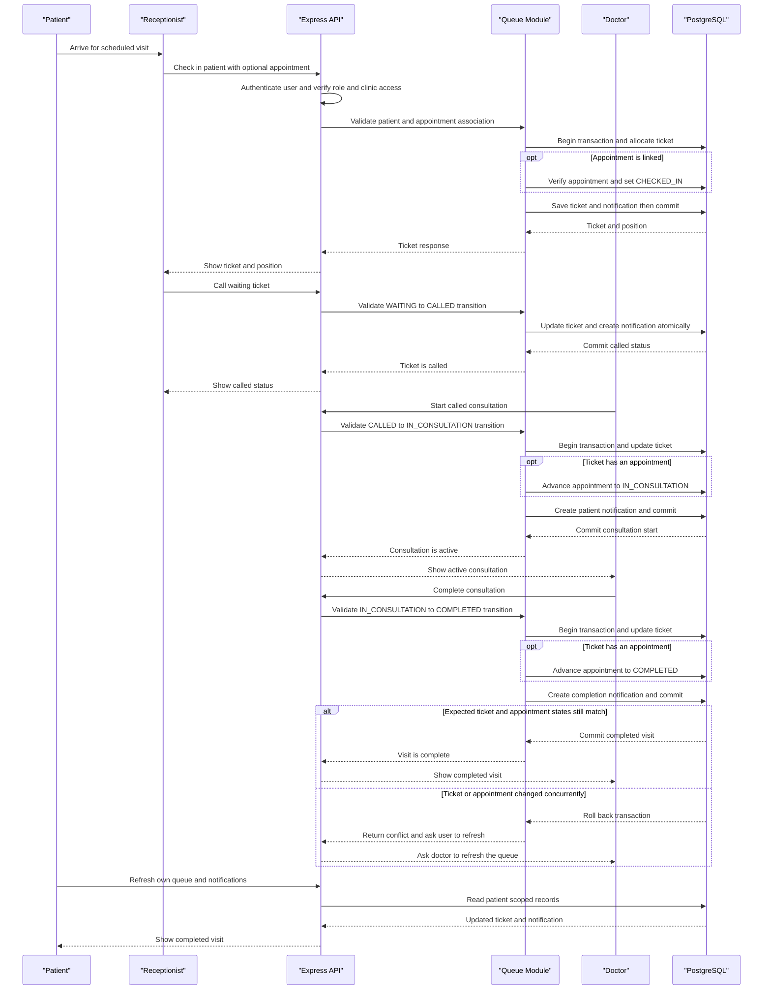

# Core Business Workflows

ClinicFlow (also branded ClinicFlow ET in parts of the UI) coordinates a clinic's staff, patient records, appointments, walk-in check-in, queues, payments, and operational reporting. Each account is assigned a role, and clinic membership determines which clinic's data the account can access.

## Domain Entities

| Entity            | Service / Bounded Context        | Description                                                                                   | Key Relationships                                                                                                   |
| ----------------- | -------------------------------- | --------------------------------------------------------------------------------------------- | ------------------------------------------------------------------------------------------------------------------- |
| User              | Identity and Access              | A person who signs in as an administrator, receptionist, doctor, or patient.                  | Can have clinic staff membership, doctor and/or patient profiles, refresh tokens, notifications, and audit entries. |
| Clinic            | Clinic Operations                | A healthcare organization and principal tenant boundary for operational records.              | Owns branches, staff, doctors, patients, appointments, queue tickets, payments, and notifications.                  |
| Branch            | Clinic Operations                | A physical clinic location within a clinic.                                                   | Belongs to a clinic; staff may be assigned to a branch.                                                             |
| StaffMember       | Workforce Management             | A user's active membership and job identity at a clinic.                                      | Links a user to a clinic and optionally to a branch; a doctor profile is attached to its staff record.              |
| Doctor            | Care Delivery                    | A clinician identity and availability at a clinic.                                            | Linked to a user and clinic; receives appointments and queue tickets.                                               |
| Patient           | Patient Management               | A clinic-specific patient record, medical record number, and contact/profile details.         | Linked to a user and clinic; owns appointments, queue tickets, and payments.                                        |
| Appointment       | Scheduling                       | A planned patient visit with an assigned doctor and time interval.                            | Belongs to a clinic, patient, and doctor; can have one queue ticket and associated payments and notifications.      |
| QueueTicket       | Check-In and Queue               | A same-day visit's position and progress through the clinic.                                  | Belongs to a clinic and patient; can reference a doctor and appointment.                                            |
| QueueDailyCounter | Check-In and Queue               | A per-clinic, per-day counter that allocates unique sequential queue numbers.                 | Owned by a clinic and used when issuing queue tickets.                                                              |
| Payment           | Billing                          | A record of an amount collected or recorded for a patient, optionally tied to an appointment. | Belongs to a clinic and patient; may reference an appointment.                                                      |
| Notification      | Patient and Staff Communications | A user-specific record of queue or appointment updates, with a read state.                    | Belongs to a clinic and user; may reference an appointment.                                                         |
| RefreshToken      | Identity and Access              | Revocable long-lived session credentials.                                                     | Associated with a user and stored as a token hash.                                                                  |
| AuditLog          | Audit                            | A record of clinic data mutations and request context.                                        | May identify the acting user and clinic, plus the action and target entity.                                         |

## Service-to-Domain Mapping

This is a modular Express monolith, not a set of independently deployed services. The modules below share one Prisma client and PostgreSQL database; the browser communicates with them through the versioned REST API.

| Service / Module      | Domain Context                   | Owned Entities                                                   | External Dependencies                                              |
| --------------------- | -------------------------------- | ---------------------------------------------------------------- | ------------------------------------------------------------------ |
| `auth`                | Identity and Access              | Password authentication and refresh tokens                       | PostgreSQL through Prisma; JWT signing                             |
| `clinics`, `branches` | Clinic Operations                | Clinic and branch records                                        | Prisma; staff membership for tenant access                         |
| `staff`, `doctors`    | Workforce Management             | Staff membership and doctor profiles                             | Prisma; clinic and branch records                                  |
| `patients`            | Patient Management               | Patient profiles and clinic-scoped MRNs                          | Prisma; shared user identity                                       |
| `appointments`        | Scheduling                       | Appointment lifecycle and conflict checks                        | Prisma; patient and doctor records in the same database            |
| `queue`               | Check-In and Queue               | Queue tickets, daily counters, queue transitions                 | Prisma; appointment and patient records; writes user notifications |
| `payments`            | Billing                          | Payment records and Chapa checkout verification                  | Prisma; patient and optional appointment records; Chapa API        |
| `notifications`       | Patient and Staff Communications | User-scoped notification retrieval and read state                | Prisma; user, clinic, and optional appointment records             |
| `reports`             | Clinic Analytics                 | Aggregated operational measures (not a separate reporting store) | PostgreSQL queries through Prisma                                  |
| `audit`               | Audit                            | Audit log records                                                | Prisma; Express request/response lifecycle                         |

There is no service-to-service REST or event-bus flow in this repository. Cross-domain work is performed by modules calling shared services or by transactional Prisma operations against the same database.

## Primary Workflows

### Workflow 1: Sign In, Restore a Session, and Route by Role

1. The user enters a phone number or email and password on `/login`.
2. The frontend posts the identifier and password to `POST /auth/login`. The API normalizes the identifier, verifies the password hash, and rejects missing, inactive, or invalid-password accounts with the same unauthorized response.
3. The API issues a short-lived JWT access token and a random refresh token. It stores only a hash of the refresh token. The frontend stores both tokens and the returned user profile in browser local storage.
4. The client routes doctors to `/doctor/overview`, patients to `/patient/dashboard`, and administrators and receptionists to `/dashboard/overview`.
5. On reload, the frontend validates an access-token session with `GET /auth/me`, or rotates a refresh token with `POST /auth/refresh` if it has only the refresh token. A rejected refresh clears the local session. A valid refresh token is rotated and the previous token is revoked.
6. The frontend's route guard redirects unauthenticated users to `/login` and routes authenticated users back to the portal for their role. Backend middleware independently checks the bearer JWT, re-reads the active user from the database, and applies route-specific role and clinic-membership checks.
7. Logout calls `POST /auth/logout`, clears the browser's tokens, user and selected-clinic cache, and clears cached React Query data.

Authentication uses phone/email and password; there are no OTP endpoints. The forgot-password page directs users to their clinic administrator because no verified self-service reset flow is available.

### Workflow 2: Administrator Sets Up a Clinic

1. An authenticated ADMIN can create a clinic through `POST /clinics`. In one database transaction, the API creates the clinic and an active administrator staff membership for the creating user.
2. The administrator can update clinic settings, create or deactivate branches, invite/create staff, and create or remove doctor profiles. Staff and doctor records are clinic-scoped.
3. The frontend determines a staff user's current clinic by loading the clinics associated with that account and caching the first clinic ID in local storage. Clinic-specific API requests carry that clinic ID.
4. For protected clinic operations, the backend requires an active user and active clinic plus an active staff membership or patient profile in that clinic. ADMIN-only operations include clinic updates, staff maintenance, branch maintenance, and doctor creation/deletion.

The registration page submits clinic, patient, and doctor registration to the corresponding authentication endpoints. Clinic registration creates the initial administrator and clinic atomically; patient and doctor registrations create the account and clinic-scoped profile.

### Workflow 3: Reception Registers a Patient and Schedules a Visit

1. ADMIN or RECEPTIONIST searches the clinic patient directory or registers a patient. `POST /patients` validates clinic access and creates or links an active PATIENT user plus a clinic-specific patient profile in a transaction. The service assigns an MRN if one was not supplied.
2. Staff selects a patient and doctor, supplies a start/end time, and creates an appointment with `POST /appointments`.
3. The appointment service verifies the patient and doctor are active members of the same clinic, requires a valid time interval, and checks for an overlapping non-terminal appointment for that doctor.
4. The appointment is saved with status `SCHEDULED` under a serializable transaction. A conflicting doctor schedule returns a conflict rather than double-booking.
5. Staff can confirm, reschedule, cancel, or check in an appointment subject to the allowed status transitions. Terminal appointments (`COMPLETED`, `CANCELLED`, `NO_SHOW`) cannot be rescheduled.

The patient portal can display that patient's appointments, but booking from the patient side is not currently implemented: appointment creation is restricted to ADMIN and RECEPTIONIST, and the portal's “Book Appointment” button navigates to a staff dashboard path that the patient route guard does not permit.

### Workflow 4: Patient Arrives, Receives a Queue Ticket, and Is Seen

1. ADMIN or RECEPTIONIST checks in a patient via `POST /queue/check-in`, optionally linking an appointment and priority.
2. The queue service verifies that the patient is active and belongs to the clinic. If an appointment is included, it verifies that the appointment belongs to that patient and clinic, that its doctor matches, and that its status is `SCHEDULED` or `CONFIRMED`.
3. Within a serializable transaction, the service increments the clinic's daily counter, issues the queue ticket, marks the linked appointment `CHECKED_IN`, and creates a queue-update notification for the patient. A unique constraint prevents duplicate queue tickets for one appointment.
4. Queue ordering uses priority first (`EMERGENCY`, then `URGENT`, then `NORMAL`) and queue number within priority. The ticket response includes its current position.
5. ADMIN or RECEPTIONIST calls a waiting ticket. A doctor or staff member starts a called ticket, then completes an in-consultation ticket. Each action validates the current queue state before updating it.
6. When a ticket linked to an appointment starts and completes, the associated appointment is advanced to `IN_CONSULTATION` and `COMPLETED`. Queue and appointment updates and the patient's status notification are committed transactionally.
7. The patient portal polls queue data and shows the ticket, state, and line position. Queue and dashboard queries refresh periodically in the frontend.

The API also permits ADMIN or RECEPTIONIST to skip a waiting or called ticket. A transition from any state other than the action's allowed source state is rejected.

**Implementation gap:** the doctor overview presents a “Call Next Patient” control and invokes the call endpoint, but the backend `/queue/:ticketId/call` route allows only ADMIN and RECEPTIONIST. A doctor clicking this control will receive a forbidden response. Doctors are allowed to start and complete visits, but cannot call or skip queue tickets under the current API permissions.

### Workflow 5: Doctor Runs a Consultation

1. The doctor signs in and lands on `/doctor/overview`. The frontend finds the clinic doctor profile linked to the signed-in user's ID; if none exists, it displays an administrator-contact message.
2. The doctor dashboard shows that doctor's queue, current called/in-consultation ticket, appointments, and relevant patient information. The doctor can update their availability status and their own allowed profile fields.
3. The doctor starts a called ticket. The API changes queue status to `IN_CONSULTATION`; if linked to an appointment, it moves that appointment from `CHECKED_IN` to `IN_CONSULTATION`.
4. On completion, the queue ticket becomes `COMPLETED` and the linked appointment becomes `COMPLETED`. The service adds a patient notification and rejects stale/concurrent transitions.

The Doctor portal navigation exposes consultation overview, queue, schedule, and patients. Its queue action controls still depend on backend permissions; the “Call Next Patient” mismatch is noted in Workflow 4.

### Workflow 6: Patient Follows Their Visit

1. A patient signs in and enters `/patient/dashboard`. The frontend requests `/patients/me` to resolve the patient's own active clinic profile; the backend chooses the first active profile associated with the user.
2. The portal displays that patient's patient-profile summary, appointments, active queue ticket, and notifications. The API scopes appointment and queue results to the authenticated patient user rather than trusting a caller-supplied patient ID.
3. Queue and notification updates are created by backend operations such as check-in, call, start, and completion. Notifications are fetched and marked read only for the authenticated user.
4. The portal presents payment receipts in its layout, but patient payment data is not currently supplied: the shared data hook does not enable payment fetching for PATIENT accounts, and the payment API is restricted to ADMIN and RECEPTIONIST.

The forgot-password page instructs users to contact their clinic administrator. The API intentionally has no unauthenticated password-reset route.

### Workflow 7: Staff Records Payment and Reviews Clinic Performance

1. ADMIN or RECEPTIONIST records manual cash, MPESA, bank-transfer, or other payments through `POST /payments`. Chapa is not accepted through this route because it would bypass provider verification.
2. An authorized staff member or the patient starts Chapa checkout through `POST /payments/chapa/initialize`. The service validates clinic, patient, optional appointment, amount, and the provider API response, then creates a pending ETB payment.
3. The patient completes hosted checkout. The API verifies the transaction with Chapa and confirms it only when transaction reference, amount, and currency match the pending record. Signed webhooks use the original request body for signature validation.
4. Staff can list payments and use reporting screens for clinic-level dashboard, revenue, appointment, and waiting-time measures. The report endpoints require ADMIN or RECEPTIONIST and clinic access.
5. The UI supports marking payment state as though that were an action, but the current API provides no payment-status update route; the client service returns an explicit “not supported” error for that operation.

## Cross-Service Data Flows

There are no independently running business services to aggregate. The main data path is:

1. A React page reads from `useClinicData` or a focused query hook.
2. `clinicService` resolves the active clinic ID, maps UI fields/enums to the API model, and invokes `apiRequest` or `apiPaginated`.
3. `apiClient` adds the bearer token, checks the standard response envelope, attempts one refresh-token rotation after an authenticated 401, and retries the original request after successful rotation.
4. Express applies correlation IDs, request logging, the response envelope, audit middleware for non-auth mutations, rate limiting, route validation, JWT authentication, role guards, and clinic-access checks as appropriate.
5. The domain module applies business rules and uses Prisma to read/write PostgreSQL. It returns a DTO which the frontend maps into UI types.

For clinic ID resolution, a staff user loads clinic memberships and uses the first listed clinic; a patient resolves their clinic from `/patients/me`. This means clinic switching is not represented in the current UI flow. Patient appointment and queue reads are filtered using the authenticated patient user ID. Notifications are always queried and marked read using the authenticated user's ID and clinic ID. Queue mutations write notification records in the same transaction as the queue state change; there is no external push/SMS notification delivery for those updates in the observed workflow.

Frontend query state is held in TanStack Query, with shared clinic data refreshed on a 30-second interval for queue, notifications, and selected statistics. Mutations invalidate the `clinic` query family so the affected views reload.

The backend and PostgreSQL are a single application's persistence path, not separate business services with a gateway fallback. The health endpoint probes PostgreSQL and reports HTTP 503 with `database unavailable` when that dependency cannot be reached. In non-production, a failed initial database connection is logged but does not prevent the server from starting, so the health endpoint exposes the unavailable dependency while database-backed requests are impaired. No stale-data or circuit-breaker fallback is implemented for that case.

## Business Workflow Sequence

<!-- mermaid-checked: every participant uses `participant Id as "Label"`, no \n in aliases/messages/notes, every alt/opt/loop closed by end, no `:` inside any alias -->

## Business Rules & Decision Logic

### Roles and access

| Role         | Intended user journey                                                               | Backend permissions relevant to that journey                                                                                                                                                                                               |
| ------------ | ----------------------------------------------------------------------------------- | ------------------------------------------------------------------------------------------------------------------------------------------------------------------------------------------------------------------------------------------ |
| ADMIN        | Owns clinic setup, workforce configuration, and clinic oversight.                   | Can create/update/deactivate clinics; manage branches, staff, doctors; manage patient, appointment, queue, and payment operations; view reports.                                                                                           |
| RECEPTIONIST | Handles patient intake, appointment scheduling, check-in, queue desk, and payments. | Can create/update patients and appointments; check patients in; call or skip queue tickets; start/complete tickets; record/list payments; view reports. Does not have ADMIN-only clinic/staff/doctor management permissions.               |
| DOCTOR       | Runs consultations and updates their availability/profile.                          | Can list clinic doctors, patients, appointments, and queue; update their own doctor profile/availability subject to field-level service checks; start and complete queue tickets. Cannot call or skip tickets in the current route guards. |
| PATIENT      | Follows their own clinic profile, appointments, queue, and notifications.           | Can read their own patient profile, appointment list, queue, and notifications. Cannot create appointments, check in, or use payment endpoints under the current route guards.                                                             |

Frontend portal checks select which pages a user sees, but backend route guards are the actual enforcement boundary. Clinic operations additionally require the user to have an active staff membership or active patient profile in the requested clinic.

### Validation and domain rules

- **Identity:** Password login accepts phone or email. Inactive accounts cannot log in or continue an authenticated request. Invalid identifiers/passwords receive a generic authentication failure.
- **Password recovery:** The API intentionally has no public self-service password-reset endpoint. Users must contact their clinic administrator.
- **Appointment scheduling:** Start and end must parse as valid dates, and end must be after start. The patient and doctor must be active in the same clinic. A doctor cannot have overlapping non-terminal appointments.
- **Appointment lifecycle:** `SCHEDULED` can become `CONFIRMED`, `CHECKED_IN`, `CANCELLED`, or `NO_SHOW`; `CONFIRMED` can become `CHECKED_IN`, `CANCELLED`, or `NO_SHOW`; `CHECKED_IN` can become `IN_CONSULTATION` or `CANCELLED`; `IN_CONSULTATION` can become `COMPLETED`. `COMPLETED`, `CANCELLED`, and `NO_SHOW` are terminal.
- **Queue admission:** Patient and optional doctor must be active in the clinic. A linked appointment must belong to the same patient and clinic, use the assigned doctor, and be `SCHEDULED` or `CONFIRMED`. One appointment can have at most one queue ticket.
- **Queue order:** Tickets are numbered per clinic and Addis Ababa-local queue date. Position prioritizes `EMERGENCY`, then `URGENT`, then `NORMAL`, and orders tickets by queue number within the same priority.
- **Queue lifecycle:** Waiting tickets may be called or skipped; called tickets may start or be skipped; in-consultation tickets may complete. Invalid or concurrent transitions are rejected rather than silently overwritten.
- **Payments:** Chapa checkout is initialized as a pending ETB payment and must be verified server-to-server before being marked complete. Payment records also support cash, bank transfer, MPESA, and other methods. Patient and optional appointment ownership are validated against the clinic.
- **Patient visibility:** Patient appointment and queue list operations use the authenticated user's linked patient identity. Notifications are fetched and acknowledged only for that authenticated user in a clinic they belong to.
- **Clinic integrity:** Clinic ID is taken from route, query, or request body (or inferred from a patient's profile where supported), validated, and checked against clinic membership before protected clinic operations.

### Transactions, errors, and audit

- Patient registration, clinic setup, appointment scheduling, check-in, and queue transitions use database transactions where multiple related rows must remain consistent. Appointment and queue concurrency-sensitive operations use serializable isolation and translate conflicts into client-visible errors.
- Authentication has dedicated rate limits and uses access-token verification plus refresh-token rotation. Reuse of a revoked refresh token invalidates the user's remaining refresh sessions.
- API request failures are returned through centralized Express error handling and the API response envelope; the frontend exposes relevant errors and provides retry or toast feedback on affected screens.
- The audit middleware records successful and failed mutating requests outside `/auth/` and `/health`, associating the request with the acting user and clinic when available.
