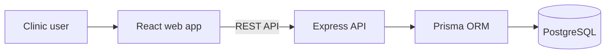

# ClinicFlow

ClinicFlow is a clinic management application designed to bring common clinic
tasks into one place. It helps clinic teams keep track of patients from
appointment booking and check-in through the queue and payment process.

The application includes a web interface for clinic staff, doctors, and
patients, with access shaped around each user's role. Its main goal is to make
day-to-day clinic work easier to organize and give staff a clearer view of
appointments and patient visits.

## Who uses ClinicFlow

- **Clinic administrators** use the staff dashboard and can access clinic
  settings.
- **Receptionists** use the staff dashboard for front-desk and daily clinic
  operations.
- **Doctors** follow their consultations, schedule, patient queue, and patients.
- **Patients** use the patient portal to access appointments, queue status, and
  billing information.

## The problem

When appointments, patient information, and check-in queues are handled
separately, it can be difficult for a clinic team to follow a visit from start
to finish. Staff may need to switch between processes to answer simple
questions, such as who is waiting or which appointments are scheduled.

## The solution

ClinicFlow connects these tasks in one application. Clinic staff can manage
appointments and patient check-ins, doctors can see relevant appointments and
queue information, and patients can use a portal for their clinic-related
information.

### A typical clinic visit

1. Staff register or find a patient and schedule an appointment.
2. When the patient arrives, staff check them in and add them to the queue.
3. The doctor follows the queue and updates the appointment as the visit
   progresses.
4. The clinic records the payment and can review activity in its reports.

## Main features

- **Clinic operations dashboard:** View the clinic overview and work with
  appointments, check-ins, the live queue, patients, doctors, payments, and
  reports.
- **Patient records:** Register patients and keep their clinic information
  organized.
- **Appointments:** Schedule appointments and follow their status.
- **Check-in and queues:** Check in patients and track the order of visits.
- **Payments:** Record payments, including online payments through Chapa.
- **Reports and notifications:** Review clinic activity and keep users
  informed.
- **Role-based dashboards:** Give administrators, receptionists, doctors, and
  patients navigation suited to their role.

## Dashboard navigation

Administrators and receptionists share the main clinic operations dashboard.
It includes **Clinic Overview**, **Appointments**, **Live Queue & Totem**,
**Patient Check-In**, **Patients Directory**, **Doctors & Suites**,
**Chapa & Payments**, **Reports & Analytics**, and **Notifications**.
Administrators also see **Clinic Settings**; receptionists do not.

Doctors have a separate workspace for **My Consultations**, **Patient Queue**,
**Schedule**, **Patients**, and **Notifications**. The patient portal provides
**Patient Portal**, **Live Ticket Status**, **Appointments**,
**Billing & Receipts**, and **Notifications**.

The Clinic Settings screen provides the clinic profile and appearance options.

## How it works

The React web app sends REST requests to the Express API. The API handles
authentication and clinic operations, and Prisma reads and writes data in
PostgreSQL.



## Technology stack

### Frontend

React, TypeScript, Vite, Tailwind CSS

### Backend and data

Node.js, Express, TypeScript, Prisma, PostgreSQL, Swagger

The frontend and backend are separate applications. Both use TypeScript; the
frontend is built with React and Vite, and the backend exposes a REST API with
interactive Swagger documentation.

## Access and data

The web interface presents different dashboard navigation for administrators,
receptionists, doctors, and patients, as described above.

## Run locally

You need Node.js, npm, and Docker with Docker Compose.

1. Start PostgreSQL:

   ```bash
   cd backend
   docker compose up -d postgres
   ```

2. Set up and start the backend:

   ```bash
   cd backend
   npm install
   cp .env.example .env
   ```

   Set a development `JWT_SECRET` and unique passwords for the seed accounts
   in `backend/.env`, then run:

   ```bash
   npm run prisma:generate
   npm run prisma:migrate
   npm run db:seed
   npm run start:dev
   ```

   The API runs at `http://localhost:3000/api/v1`.
   API documentation is available at `http://localhost:3000/api/docs`.

3. In a new terminal, set up and start the frontend:

   ```bash
   cd frontend
   npm install
   cp .env.example .env.local
   npm run dev
   ```

   The frontend runs at `http://localhost:5173`. Its
   `VITE_API_BASE_URL` should be `http://localhost:3000/api/v1`.

## Tests

Run backend tests from `backend/`:

```bash
npm test
```

Run frontend tests from `frontend/`:

```bash
npm test
```

## Project structure

```text
clinic/
├── backend/
│   ├── prisma/
│   │   ├── migrations/
│   │   ├── schema.prisma
│   │   └── seed.ts
│   ├── src/
│   │   ├── appointments/
│   │   ├── audit/
│   │   ├── auth/
│   │   ├── branches/
│   │   ├── clinics/
│   │   ├── common/
│   │   ├── doctors/
│   │   ├── health/
│   │   ├── notifications/
│   │   ├── patients/
│   │   ├── payments/
│   │   ├── prisma/
│   │   ├── queue/
│   │   ├── reports/
│   │   ├── staff/
│   │   ├── swagger/
│   │   └── tenancy/
│   └── test/
├── frontend/
│   ├── src/
│   │   ├── assets/images/
│   │   ├── components/
│   │   │   ├── layout/
│   │   │   └── ui/
│   │   ├── lib/
│   │   │   ├── hooks/
│   │   │   └── services/
│   │   ├── pages/
│   │   │   ├── auth/
│   │   │   ├── dashboard/
│   │   │   ├── doctor/
│   │   │   ├── patient/
│   │   │   └── public/
│   │   └── types/
│   └── test/
│
└── README.md
```

**Live application:** [clinicflow-web-one.vercel.app](https://clinicflow-web-one.vercel.app/)

## Built by

**Zenebu Melaku**
