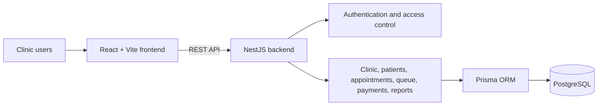

<div align="center">

# MediFlow ET

### Clinic operations, brought together.

An electronic healthcare and clinic management platform for coordinating appointments, patient records, clinic queues, payments, and reporting.

**Designed and built by Zenebu Melaku · Fullstack Developer**

<br />


<br />


</div>

---

## Overview

MediFlow ET brings the everyday work of a clinic into one role-aware application. Administrators and front-desk staff can coordinate clinic operations, doctors can follow appointments and patient queues, and patients have a dedicated portal for their visit information.

The project is built as a full-stack application with a React and Vite frontend, a NestJS API, and PostgreSQL persistence managed through Prisma.

## What it includes

| Clinic operations | Patient care | Platform foundation |
| --- | --- | --- |
| Clinics and branches | Patient records | Role-based access |
| Staff and doctor management | Appointment workflows | JWT authentication |
| Check-in and queue management | Patient portal | Clinic-scoped access |
| Payment records | Visit status | Request validation |
| Reports and analytics | Notifications | Swagger API docs |

### Role-focused experiences

- **Administrators** — oversee clinic operations, staff, and reporting.
- **Receptionists** — manage patient registration, appointments, check-in, and queues.
- **Doctors** — review relevant patient information and manage their appointment and queue workflows.
- **Patients** — access their portal and follow appointment, queue, and payment details.

## Technology

| Area | Tools |
| --- | --- |
| Frontend | React, TypeScript, Vite, TanStack Query, Tailwind CSS |
| Backend | NestJS, TypeScript, Passport, JWT |
| Data | PostgreSQL 16, Prisma ORM |
| API | REST, Swagger / OpenAPI |
| Security and validation | Helmet, class-validator, role and clinic access controls |

## Architecture



## Get started

### Prerequisites

- Node.js 20 or newer
- npm
- Docker with Docker Compose, or a PostgreSQL 16 instance

### 1. Start the database

The backend includes a Compose service for local PostgreSQL. From the backend directory:

```bash
cd backend
docker compose up -d postgres
```

### 2. Configure and start the API

In a second terminal, from the repository root:

```bash
cd backend
npm ci
cp .env.example .env
npm run prisma:generate
npm run prisma:migrate
npm run db:seed
npm run start:dev
```

Update `backend/.env` before running the seed. Use private development values for `JWT_SECRET`, `OTP_PEPPER`, and `SEED_PASSWORD`; never commit your `.env` file. The included development OTP adapter writes codes to the backend console.

The API is available at `http://localhost:3000/api/v1`. The health check is `http://localhost:3000/api/v1/health`, and Swagger docs are at `http://localhost:3000/api/docs` when enabled.

### 3. Configure and start the frontend

In another terminal, from the repository root:

```bash
cd frontend
npm ci
cp .env.example .env.local
npm run dev
```

The frontend runs at `http://localhost:5173`. Set `VITE_API_BASE_URL` in `frontend/.env.local` to the API base URL:

```env
VITE_API_BASE_URL=http://localhost:3000/api/v1
```

Only public configuration belongs in `VITE_*` variables. Do not put database credentials, signing keys, or API secrets in frontend environment variables.

## Useful commands

Run commands from the corresponding `backend/` or `frontend/` directory.

### Backend

| Command | Purpose |
| --- | --- |
| `npm run start:dev` | Start the API in watch mode |
| `npm run build` | Build the API |
| `npm run test` | Run backend test suites |
| `npm run lint` | Lint backend TypeScript |
| `npm run typecheck` | Type-check the backend |
| `npm run prisma:studio` | Open Prisma Studio |

For production, apply committed migrations with `npm run prisma:migrate:deploy`; see [backend/README.md](./backend/README.md) for environment and deployment guidance.

### Frontend

| Command | Purpose |
| --- | --- |
| `npm run dev` | Start the Vite development server |
| `npm run build` | Build the frontend |
| `npm run preview` | Preview the production build |
| `npm run lint` | Type-check the frontend |
| `npm run test` | Run frontend tests |

## Project layout

```text
.
├── backend/
│   ├── prisma/       # Database schema, migrations, and seed
│   ├── src/          # NestJS modules and API
│   └── test/         # Backend tests
├── frontend/
│   └── src/          # React application
└── README.md
```

## API modules

The API is organized around the application's core domains:

`Authentication` · `Clinics` · `Branches` · `Staff` · `Doctors` · `Patients` · `Appointments` · `Queue` · `Payments` · `Notifications` · `Reports`

Explore endpoints interactively through Swagger at `/api/docs` while the backend is running.

## Security notes

- Keep backend secrets in the backend environment, never in source control.
- Use unique, strong `JWT_SECRET` and `OTP_PEPPER` values outside local development.
- Configure an explicit allowed CORS origin for production.
- The console OTP delivery adapter is for development only; production requires a configured delivery provider.
- Review [backend/README.md](./backend/README.md) for production configuration and deployment details.

## About the developer

**Zenebu Melaku** is a Fullstack Developer interested in building practical, reliable, and user-centered software. MediFlow ET demonstrates full-stack development across frontend experiences, API design, authentication, and data persistence.

## License

This repository is marked `UNLICENSED` in the backend package. Contact the project owner for permission before reusing or distributing the code.

<div align="center">

**MediFlow ET · Built with care for better-organized clinic workflows.**

</div>
